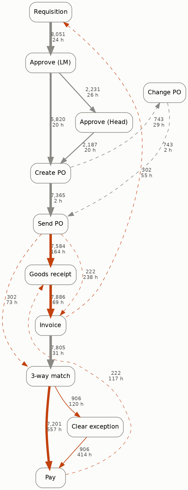
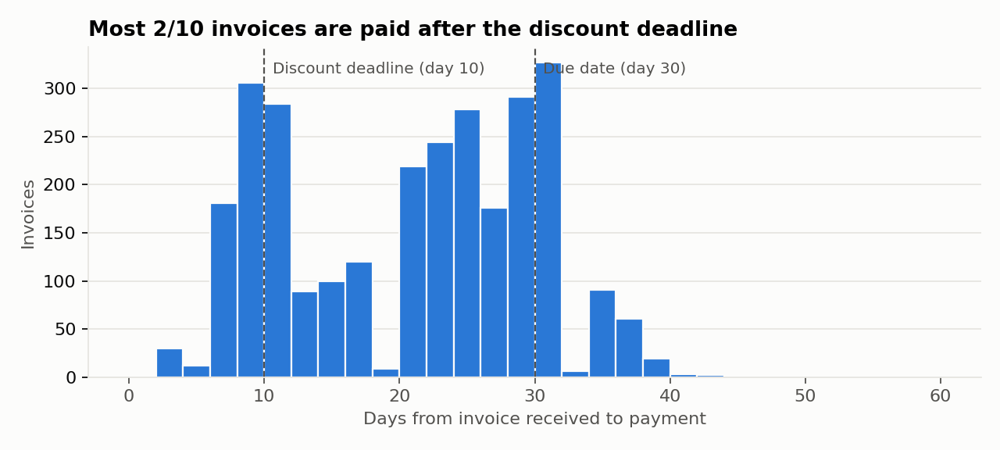
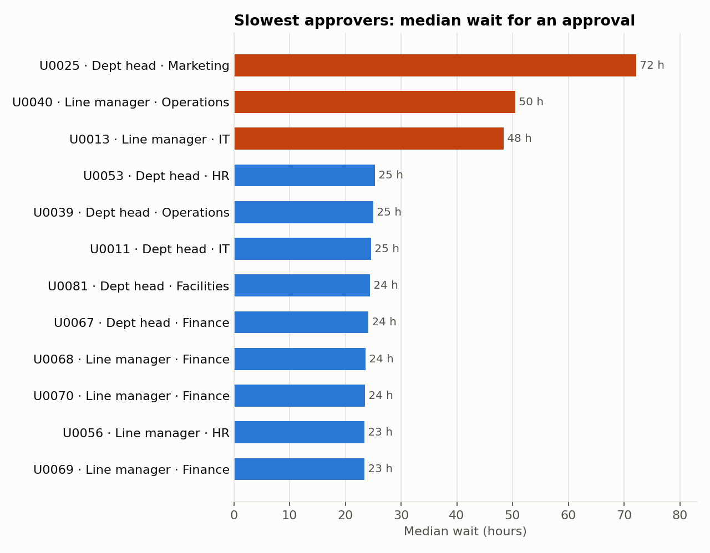

# Procure-to-Pay Process Mining

**Rebuilding how purchases actually flow through a company from ERP event logs, then finding where they get stuck, where controls are bypassed, and what that costs.**

On paper, procure-to-pay (P2P) is a clean sequence: request, approve, order, receive, invoice, pay. In practice, purchases skip approvals, invoices arrive before orders exist, and payments go out too late to earn early-payment discounts. No single department sees the whole picture. Process mining rebuilds it from the timestamps every ERP system already records.

This is an end-to-end business analysis case study: requirements, process design, a synthetic ERP event log, process discovery, bottleneck and control analysis, and recommendations with dollar values.



*The discovered process. Arrow thickness = number of purchases; labels = count and median wait. Orange = median wait of 48 hours or more. Dashed = deviations from policy.*

---

## Key findings

All figures come from `python analyze.py` on the synthetic 2025 log: **8,108 purchases, 68,778 events**.

| KPI | Result | Target |
| --- | --- | --- |
| Median end-to-end cycle time | 38.2 days | ≤ 30 days |
| Median requisition-to-PO time | 2.0 days | – |
| Happy-path rate | 74.2% | ≥ 70% ✅ |
| On-time payment rate | 76.4% | ≥ 95% ❌ |
| **Early-payment discount capture** | **18.7%** | ≥ 90% ❌ |
| **Purchases breaking a control rule** | **11.2%** | ≤ 2% ❌ |

### 1. USD 231K of early-payment discounts missed

2,849 invoices offered 2% off for payment within 10 days, worth USD 285K. Only 18.7% were paid in time. Accounts Payable runs payments **on Thursdays only** and pays most invoices close to the 30-day due date, regardless of terms.



### 2. USD 231K paid twice

47 invoices were paid twice. No check stops the same supplier invoice number from going into a second payment run.

### 3. Three approvers are 2–3× slower than their peers

| Approver | Level | Median wait | Peers |
| --- | --- | --- | --- |
| U0025 · Marketing | Department head | 72 h | 26 h |
| U0040 · Operations | Line manager | 50 h | 24 h |
| U0013 · IT | Line manager | 48 h | 24 h |



### 4. Control violations cluster by department

| Rule | Purchases | Value (USD) | Where it concentrates |
| --- | --- | --- | --- |
| C1 Missing approval | 79 | 451K | Spread evenly |
| C2 After-the-fact PO | 302 | 1.50M | **Marketing: 8.1% of purchases** (others ≤ 4.4%) |
| C3 Split purchase | 177 | 672K | **Facilities: 5.2%** (others ≤ 1.9%) |
| C4 Segregation of duties | 90 | 428K | Spread evenly |
| C5 Paid before goods receipt | 222 | 1.11M | **Operations: 5.4%** (others ≤ 2.4%) |
| C6 Duplicate payment | 47 | 231K | Spread evenly |

The dollar values for C1–C5 are the purchase amounts at risk, not money lost.

## Recommendations

| # | Change | Owner | Estimated value |
| --- | --- | --- | --- |
| 1 | Add a second weekly payment run, and pay 2/10 invoices by discount deadline rather than due date | AP / Treasury | Up to USD 231K a year |
| 2 | Block payment of any supplier invoice number already paid | AP / ERP team | USD 231K a year of duplicates prevented |
| 3 | 48-hour approval SLA with automatic escalation, plus delegation during absence | Head of Procurement | Speeds up the 19% of purchases that wait on the three slowest approvers |
| 4 | Blanket POs for Marketing events and recurring agency spend | Marketing + Procurement | Brings 132 after-the-fact purchases a year under control |
| 5 | Review the USD 5K threshold and set up catalogue buying for Facilities | Procurement | Removes the incentive behind 68 split purchases |
| 6 | Enforce the three-way match block for Operations | Finance / ERP team | Stops 96 payments made before goods arrive |

The biggest single wait (*three-way match → pay*, median 23 days) is mostly **intentional**: the company holds cash until the due date. Shortening it would hurt cash flow, so the recommendations target approvals and payment *timing* instead. That's the difference between a bottleneck and a policy choice.

## Business analysis deliverables

- 📄 [Business Requirements Document](docs/Business_Requirements_Document.pdf): scope, stakeholders, RACI, target process, KPIs, six control rules, 10 functional and 5 non-functional requirements, 7 user stories with acceptance criteria, data requirements, risks and UAT plan
- 📊 [Full findings](output/findings.md), generated from the data
- 📝 [Case study](docs/case_study.md): problem, approach, results, root causes and recommendations, written for a hiring manager

## How it works

```
generate_event_log.py  →  data/events.csv, cases.csv, users.csv, suppliers.csv, planted_issues.csv
analyze.py             →  output/ (variants, transitions, approver waits, control flags, findings, charts)
```

| Step | Method |
| --- | --- |
| Data quality | Missing fields, duplicate events, cases without a requisition |
| Process discovery | Variants (unique activity sequences) and a directly-follows graph |
| Bottlenecks | Wait time per transition, ranked by total waiting time; approvers compared with peers at the same approval level |
| Controls | Six rule checks (C1–C6) on every purchase, each flag saved with its evidence |
| Cash impact | Missed 2/10 discounts, duplicate payments, late payments |
| Validation | 13 unit tests on hand-made cases, plus flags compared with the generator's answer key |

**About the 100% detection score:** every planted violation was found and nothing was falsely flagged. That's expected, because the test data was built to the same rule definitions, so it proves the checks are implemented correctly rather than that they'd be perfect on real data. On real data, the hard part is agreeing on legitimate exceptions with Procurement (emergency purchases, for example), which the requirements document addresses.

## Dataset

Real ERP logs are confidential, so `generate_event_log.py` creates a realistic synthetic one. It includes office hours and weekends, Thursday payment runs, slow approvers, PO rework (9%), invoice exceptions (11%), and control violations planted at known rates with department-level patterns. 69 split purchases occurred **by coincidence** rather than being planted. They meet the rule anyway, so they're kept in the answer key.

## Run it

```bash
pip install -r requirements.txt
python generate_event_log.py --seed 7 --out data
python analyze.py --data data --out output
python -m pytest -q        # 13 tests for the control rules and metrics
```

The process map needs [Graphviz](https://graphviz.org/download/) installed; everything else runs without it.

## Skills demonstrated

Process mining · process mapping · requirements elicitation · stakeholder analysis · KPI design · internal controls (segregation of duties, three-way match) · root-cause analysis · Python (pandas) · data visualisation · business recommendations with quantified value

## How this was built

Built with AI assistance (Claude) for code generation and drafting. I defined the business problem, requirements, rules and analysis approach, and reviewed and validated all outputs.

## Author

**Hari** · MSc in Artificial Intelligence · aspiring Business Analyst
[GitHub](https://github.com/Harigovindbn) · [LinkedIn](https://www.linkedin.com/in/harigovind-b-nair-7b99b0373/)
